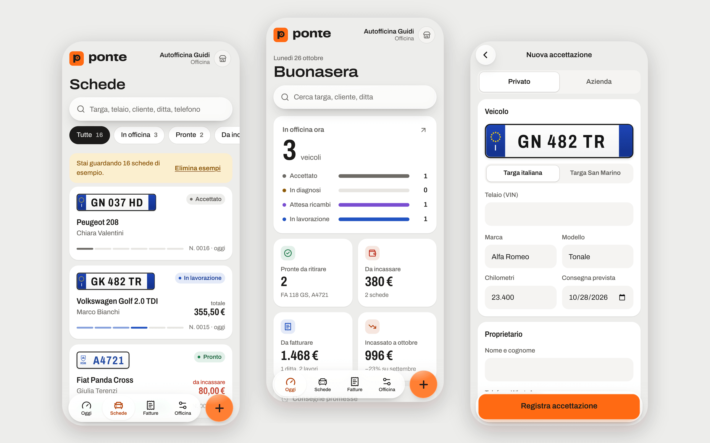
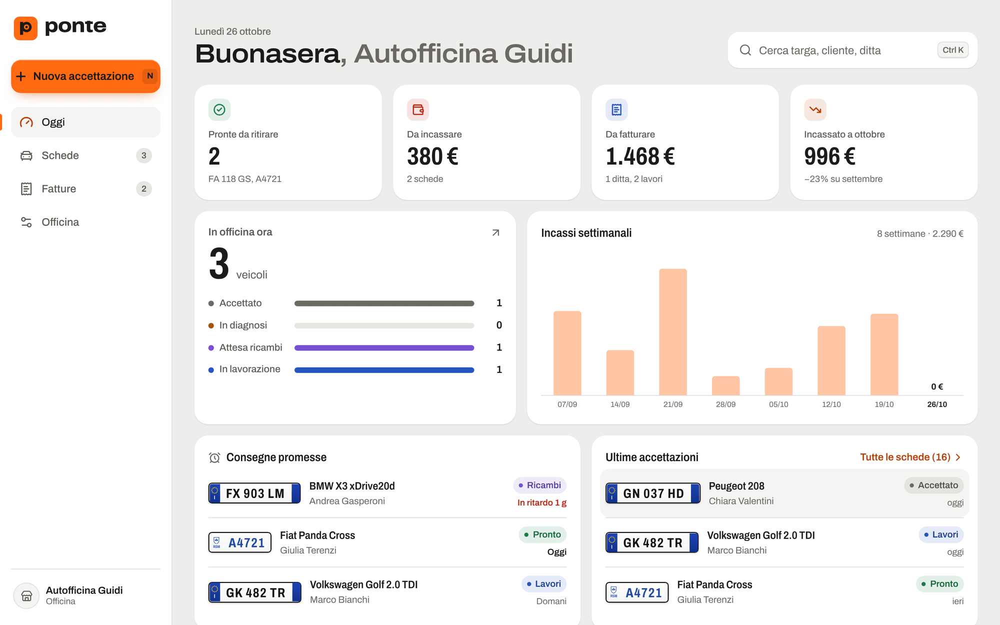
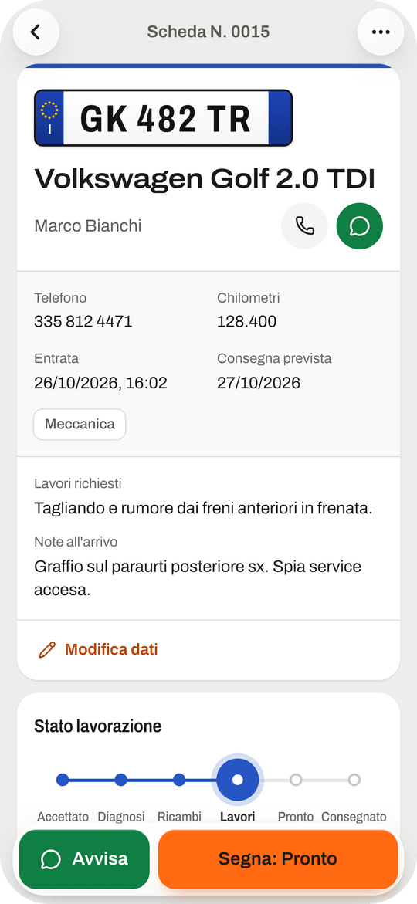
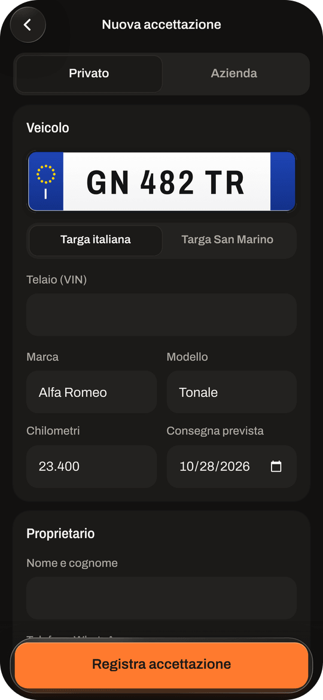

<div align="center">

<picture>
  <source media="(prefers-color-scheme: dark)" srcset="brand/ponte-logo-white.svg">
  
</picture>

### Il registro dell'officina.

Accettazione, stato dei lavori, avvisi WhatsApp, conti e fatture ditte.<br>
Per officine meccaniche, elettrauti e gommisti. Dal telefono, anche offline.<br>
**[Prova la web app →](https://martinminotti.github.io/ponte/)**

[](https://github.com/martinminotti/ponte/actions/workflows/ci.yml)
[](https://martinminotti.github.io/ponte/)
[](https://github.com/martinminotti/ponte/actions/workflows/ios-testflight.yml)


<br>

<picture>
  <source media="(prefers-color-scheme: dark)" srcset="docs/screenshots/hero-dark.png">
  
</picture>

</div>

<br>

## Perché Ponte

In officina il lavoro vero si fa sotto il ponte, non al computer. Eppure ogni auto che entra si porta dietro carta: il foglio di accettazione, il post-it con il telefono del cliente, il conto scritto a mano, le fatture delle ditte da rimettere insieme a fine mese.

Ponte mette tutto questo in tasca. Un'auto si accetta in trenta secondi scrivendo la targa, il cliente sa a che punto è il lavoro senza telefonare, il conto parte in PDF su WhatsApp e a fine mese le ditte sono già raggruppate e pronte da fatturare.

<table>
<tr>
<td width="33%" valign="top">

**30 secondi**<br>
<sub>per accettare un veicolo. Se è già passato in officina, un tocco ricopia cliente e ditta.</sub>

</td>
<td width="33%" valign="top">

**Zero telefonate**<br>
<sub>a ogni cambio di stato Ponte propone il messaggio WhatsApp già scritto.</sub>

</td>
<td width="33%" valign="top">

**Un conto al mese**<br>
<sub>per ogni ditta, con IVA divisa per aliquota e incasso segnato su tutti i lavori insieme.</sub>

</td>
</tr>
</table>

## Funzionalità

### La giornata a colpo d'occhio
- **Oggi**: quante auto sono sul ponte e in che fase, pronte da ritirare, da incassare, da fatturare, incassato del mese rispetto al precedente.
- **Consegne promesse** con ritardi evidenziati e **incassi settimanali** delle ultime otto settimane.

### Accettazione e archivio
- **Targa disegnata**, italiana o di San Marino, con telaio, marca, modello, chilometri e consegna prevista.
- **Già visto**: Ponte riconosce targa e telaio e propone i dati dell'ultima visita.
- **Foto all'arrivo** di graffi, cruscotto e chilometri, compresse sul dispositivo.
- **Ricerca unica** per targa, telaio, cliente, ditta, P.IVA, telefono, operaio o numero scheda, con filtri e conteggi.

### Lavorazione e cliente
- **Binario a sei tappe**, da *Accettato* a *Consegnato*, con cronologia e operai assegnati.
- **WhatsApp** con un messaggio pronto per ogni stato, modificabile, nel rispetto del consenso del cliente.
- **Conto A4 in PDF** con logo, dati dell'officina, acconto, garanzia e metodo di pagamento. Su telefono si condivide già allegato.

### Ditte e fatturazione
- **Clienti azienda** con ragione sociale, P.IVA o COE, codice fiscale, SDI o PEC.
- **IVA** al 22, 17, 10, 4 % o esente, importi IVA inclusa o esclusa.
- **Fatture mensili**: i lavori di ogni ditta si raccolgono nel mese in un unico conto; fattura emessa e incasso si segnano in un colpo.

### Pensato per l'uso vero
- **Offline sempre**: l'archivio vive sul dispositivo, nessun account, nessun canone.
- **Annulla** su eliminazioni, voci e incassi. **Backup** completo con foto, promemoria settimanale.
- **Vetro liquido su iOS**, tema chiaro e scuro, vibrazione aptica, tasto indietro su Android.
- **Tablet e desktop** con cruscotto a tutta larghezza, archivio e scheda affiancati, scorciatoie da tastiera (<kbd>⌘K</kbd> cerca, <kbd>N</kbd> nuova accettazione, <kbd>↑</kbd> <kbd>↓</kbd> scorre le schede).

<br>

<div align="center">

<picture>
  <source media="(prefers-color-scheme: dark)" srcset="docs/screenshots/desktop-dark.png">
  
</picture>

<sub>Su computer la giornata a colpo d'occhio, a tutta larghezza.</sub>

<br><br>


&nbsp;&nbsp;


</div>

<br>

## Per chi è

| | |
|---|---|
| 🔧 **Officine meccaniche** | Tagliandi, diagnosi, attesa ricambi: ogni auto ha la sua scheda e il suo stato. |
| ⚡ **Elettrauti** | Diagnosi, ricambi e garanzia sulla riparazione, con il conto pronto per il cliente. |
| 🛞 **Gommisti** | Cambio stagionale veloce, misure gomme sulla scheda, storico per targa. |
| 🏢 **Chi lavora con le ditte** | Flotte e aziende con fatturazione mensile e IVA corretta. |

Pensato per l'Italia e San Marino: targhe RSM, COE, regime IVA sammarinese.

## Piattaforme

| | Come si usa |
|---|---|
| **iPhone e iPad** | App nativa, distribuita via TestFlight e App Store. |
| **Android** | App nativa dallo stesso codice, pronta per il Play Store. |
| **Web** | Si apre dal browser e si installa sulla schermata Home, funziona offline. |

Un'unica base di codice (React, TypeScript, Capacitor) per tutte e tre.

## Iniziare

```bash
git clone https://github.com/martinminotti/ponte.git
cd ponte
npm install
npm run dev
```

Apri http://localhost:5173: al primo avvio Ponte propone alcune schede di esempio per provarlo subito.

| Documento | Contenuto |
|---|---|
| [docs/sviluppo.md](docs/sviluppo.md) | Stack, struttura, modello dei dati, marchio, sicurezza, backend |
| [docs/rilascio.md](docs/rilascio.md) | Pubblicazione web, TestFlight da GitHub Actions, Android |
| [brand/STYLEGUIDE.md](brand/STYLEGUIDE.md) | Marchio, colori, tipografia, voce, componenti |

## Dati e privacy

I dati dei clienti restano sul dispositivo dell'officina: nessun server, nessun tracciamento, nessuna libreria caricata da CDN. Il consenso ai messaggi WhatsApp è registrato su ogni scheda. Per non perdere nulla Ponte chiede al sistema di proteggere l'archivio e ricorda il backup ogni settimana.

> I documenti generati sono riepiloghi per il cliente, non fatture fiscali. La fattura elettronica va emessa con il proprio gestionale o con il portale SDI. Le aliquote IVA proposte vanno verificate con il commercialista.

## In arrivo

- [ ] Sincronizzazione tra più dispositivi della stessa officina
- [ ] Accesso con ruoli per titolare e operai
- [ ] Pubblicazione su App Store e Play Store
- [ ] Esportazione verso la fattura elettronica
- [ ] Promemoria revisione e cambio gomme ai clienti

## Licenza

Da definire dal proprietario del repository.

<br>

<div align="center">
<sub>Ponte prende il nome dal ponte sollevatore: la "p" del marchio ha la pancia a forma di pneumatico.</sub>
</div>
